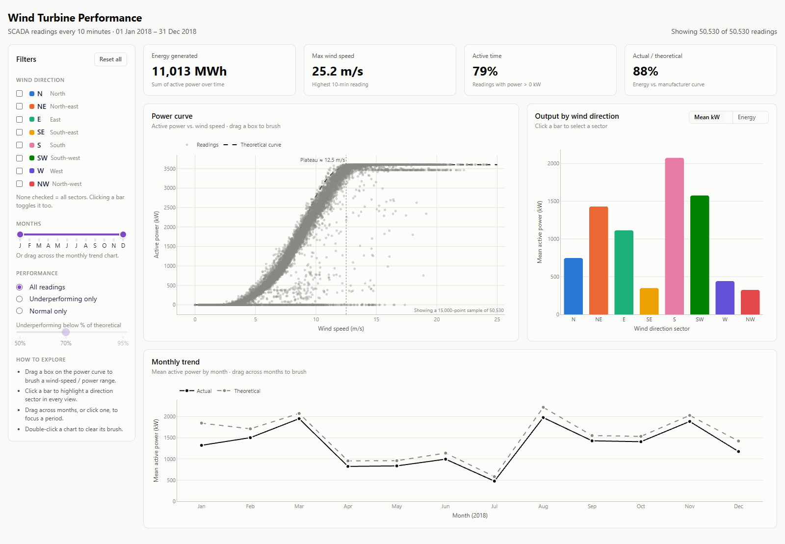
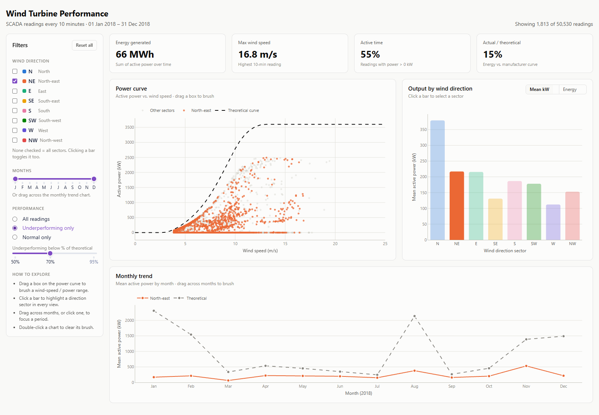

# Wind Turbine Performance Dashboard

Interactive Plotly Dash dashboard for the [Wind Turbine SCADA dataset](https://www.kaggle.com/datasets/berkerisen/wind-turbine-scada-dataset).
It has three linked views (power curve, sector bars, monthly trend) with cross-filtering and a KPI row.

**Live prototype:** https://wind-turbine-dashboard.onrender.com
(The free host sleeps when idle, so the first load can take about a minute.)

**Repository:** https://github.com/rohithanbu/wind-turbine-dashboard




## Run locally

Requires **Python 3.11 or newer** (tested with Python 3.14) and Git.

```bash
git clone https://github.com/rohithanbu/wind-turbine-dashboard.git
cd wind-turbine-dashboard
python -m venv .venv
.venv\Scripts\activate            # macOS/Linux: source .venv/bin/activate
pip install -r requirements.txt
python app.py
```

Then open **http://127.0.0.1:8050** in a browser. Press `Ctrl+C` in the terminal to stop the server.

- The dataset (`data/T1.csv`) is included in the repository, so no Kaggle account or download is needed.
  To fetch a fresh copy from Kaggle instead, run `python scripts/download_data.py`.
- If port 8050 is already in use, stop the other process, or change the port in `app.py`: `app.run(debug=True, port=8051)`.
- On macOS/Linux, use `python3` in place of `python` if `python` isn't found.

## Dataset

`T1.csv`: SCADA readings from **one wind turbine** (in Turkey, per the Kaggle description), logged every 10 minutes from 1 Jan to 31 Dec 2018,
**50,530 rows**. The full file is loaded; every filter and KPI uses all rows.

| Dimension | Source | Type | Used for |
|---|---|---|---|
| Active power (kW) | raw | Quantitative | Scatter y, bar length, line y, KPIs |
| Wind speed (m/s) | raw | Quantitative | Scatter x, max-wind KPI |
| Theoretical power (kW) | raw | Quantitative | Dashed reference curve, performance ratio |
| Wind direction (°) | raw | Quantitative, binned into sectors | Sector (below) |
| Wind direction sector (N … NW) | derived | Nominal (categorical) | Hue in all views, bar x |
| Timestamp | raw | Ordinal (time) | Header date range |
| Month (Jan … Dec) | derived | Ordinal | Line x, month filter |
| Performance ratio (actual ÷ theoretical) | derived | Quantitative | "Underperforming" filter, KPI |

## Research questions and views

| # | Research question | Answered by |
|---|---|---|
| RQ1 | How does active power correlate with wind speed, and at what wind speed does the turbine reach peak efficiency before the power curve flattens? | **Power curve** scatter (with theoretical curve and plateau marker) |
| RQ2 | Which wind direction sectors consistently yield the highest power generation, and does this efficiency change across different months? | **Output by wind direction** bars, linked to the **Monthly trend** line (one line per selected sector) |
| RQ3 | When cross-filtering by low-performance periods, do anomalies appear in the theoretical vs actual power curve? | **Performance** filter ("Underperforming only") applied to all three views and the KPI row |

## Findings

All figures are computed from the full 2018 dataset. The **"See it in the dashboard"** steps reproduce each one.

### RQ1: Power vs. wind speed, and where the curve flattens

**Active power is strongly correlated with wind speed** (Pearson r = 0.91; Spearman ρ = 0.93), but the relationship is an
S-shaped power curve, not a straight line:

| Wind speed | Typical output (median) | Phase |
|---|---|---|
| below ~3 m/s | 0 kW | Below **cut-in**: too little wind to generate |
| 4–8 m/s | 86 → 1,363 kW | Output rises |
| **9–10 m/s** | 1,887 → 2,402 kW | **Steepest gain: about +520 kW per extra 1 m/s** |
| 12–13 m/s | 3,311 → 3,551 kW | Approaching rated power |
| **≥ 14 m/s** | **≈ 3,600 kW, flat** | **Rated power**: more wind adds no output |

- **The curve flattens at about 12.5 m/s.** This is where median output first reaches 95% of its maximum (the dotted
  "Plateau" line on the power curve). It is fully flat at about 3,600 kW from 14 m/s.
- **"Peak efficiency" has two readings, and the data answers both:**
  - The turbine *gains* power fastest at **9–10 m/s**.
  - It tracks its manufacturer curve most closely at **13 m/s and above**, at 93–99% of theoretical, compared with
    only about 68% around 4 m/s, just above cut-in.

**See it in the dashboard:** with no filters set, the power curve shows the S-shape, the dashed theoretical curve and the
"Plateau ≈ 12.5 m/s" marker. Hover over points for exact values.

### RQ2: Which directions produce the most, and does it change by month?

**Over the year, North-east and South dominate:**

| Sector | Energy (MWh) | Share of time | Mean power |
|---|---|---|---|
| **North-east** | **4,576** (42% of all energy) | **38%** | 1,431 kW |
| **South** | 2,428 | 14% | **2,075 kW** (highest) |
| South-west | 1,721 | 13% | 1,577 kW |
| East | 1,382 | 15% | 1,115 kW |
| N, W, NW, SE | 92–498 each | 3–8% each | 325–747 kW |

North-east produces the most energy because the wind comes from there most often. South has the strongest winds but
blows less often.

**The leading direction changes with the season:**
- **Winter (Dec–Mar): South leads.** In March, South and South-west together give 1,284 MWh.
- **Apr–Nov: North-east leads every month.** August NE (1,207 MWh) is the largest single sector-month of the year.
  In August, the S, SW, W and NW sectors produced almost nothing.

**Efficiency (actual ÷ theoretical) changes by month too:**
- Most sector-month combinations sit at **85–95%**.
- **South is the most consistent**, at 83–98% in every month except July (76%). In August, South had too little
  wind for a ratio.
- The low outliers are concentrated in winter: **North-east in January (30%)** and **December (55%)**, and **North in
  January (52%)**.
- So the drop is driven by the *month*, not by the direction itself. That leads into RQ3.

**See it in the dashboard:**
1. Switch the bar chart between **Mean kW** and **Energy** to compare strength with total output.
2. Click the **NE** bar, then the **S** bar. The monthly trend draws one line per selected sector against the
   theoretical line, showing the seasonal swap.

### RQ3: Do anomalies appear when filtering to low-performance periods?

**Yes.** With **"Underperforming only"** selected (below 70% of theoretical, among readings where theoretical power
is at least 100 kW), **4,254 of 39,288 readings (10.8%)** remain. In those readings, actual output fell short of the
theoretical curve by about **721 MWh**, about 6% of the 12,567 MWh the curve predicts for the year.
Three distinct anomaly types appear:

1. **Full stoppages:** a line of points at 0 kW while the wind was blowing.
   - 1,852 readings produced nothing while the curve expected real output.
   - The longest stoppage was **24–26 January: 44.5 hours at 0 kW** in an average wind of 9.6 m/s, when the
     curve predicts about 2,500 kW on average.
   - Other long stops: 14 Jan (21 h), 25 Feb (16 h), 4 Dec (16 h), 19 Dec (14 h).
2. **Partial output in strong wind:** at 12 m/s and above, where the turbine should be near 3,600 kW, some readings
   form flat horizontal clusters, notably around **2,250–2,500 kW** and **250–500 kW**. A second flat band just under
   rated power (**3,400–3,500 kW**, 683 readings above 14 m/s) is visible in the unfiltered view. Flat lines like these
   suggest deliberate output limits (curtailment or derating) rather than random noise.
3. **A winter cluster:** underperformance is seasonal.

   | Month | Share of readings underperforming |
   |---|---|
   | **January** | **28%** |
   | **December** | **28%** |
   | April | 17% |
   | February | 14% |
   | August, October | 2% (lowest) |

   By direction, **N, NW and W** underperform most (19–22% of their readings) and **South** least (5%).

The winter pattern, with long stops in moderate wind, is consistent with icing, cold-weather shutdowns or winter
maintenance. **The dataset has no fault or status codes**, so the cause can't be confirmed from this data alone.

**See it in the dashboard:**
1. Select **Underperforming only**. The power curve shows the 0 kW line and the partial-output clusters below the
   dashed curve, and the actual ÷ theoretical KPI drops from 88% to 18%.
2. Look at the monthly trend: the gap between actual and theoretical is largest in **January and December**.
3. Drag a box around the partial-output points at 12+ m/s on the power curve. The bars and monthly trend update to
   show which directions and months they came from.
4. Use the threshold slider (50–95%) to test how sensitive the result is to the 70% cut-off.

### Data-quality notes

- **2,030** of 52,560 expected 10-minute intervals are missing (mostly January and September–November).
- **57** readings show slightly negative power (down to −2.5 kW): the turbine drawing power while idle.
- **About 1,080** readings are more than 10% *above* the theoretical curve, mostly at low wind speeds, where the
  manufacturer curve is least precise.

## Data preparation

All preparation is in [`dashboard/data.py`](dashboard/data.py):

| Step | What and why |
|---|---|
| Column renaming | The 5 raw columns are renamed by position (`timestamp`, `active_power`, `wind_speed`, `theoretical_power`, `wind_direction`), because the degree sign in `Wind Direction (°)` is mis-encoded in the CSV. The file is read as Latin-1 for the same reason. |
| Date parsing | `Date/Time` is parsed with the explicit format `DD MM YYYY HH:MM`, and `month` (1–12) is derived from it. |
| Direction binning | Wind direction (0–360°) is binned into 8 compass sectors of 45° each (N, NE, … NW), each centred on its heading, so N covers 337.5°–22.5°. |
| Performance ratio | `perf_ratio = active_power / theoretical_power`, computed only where theoretical power is at least 100 kW. Below cut-in the denominator is near zero and the ratio would be noise. Readings below 70% (adjustable from 50–95%) count as "underperforming". |
| Negative power | The 57 negative readings are kept as-is in the charts and clipped to 0 when summing energy. |
| Missing intervals | The 2,030 missing intervals are left as gaps, not interpolated; monthly figures are means of the readings that exist. |
| Aggregation | The bar chart gives the per-sector mean power and energy (MWh = kW × 1/6 h ÷ 1000). The trend chart gives mean power per month. The theoretical curve is averaged into 0.5 m/s bins. The plateau marker is the wind speed where the binned median power first reaches 95% of its peak. It is hidden in "Underperforming only" mode, where it would not describe the turbine's curve. |
| Scatter sampling | The scatter draws a fixed random sample of 15,000 points so the page stays responsive, and labels it as a sample on the chart. Filters, KPIs and the other views always use the full data. |

## Visual encodings

| Data | Type | Mark | Channel | View |
|---|---|---|---|---|
| Active power | Quantitative | Point / bar / line | Y-position; bar length on a zero baseline | All three |
| Wind speed | Quantitative | Point | X-position | Power curve |
| Theoretical power | Quantitative | Line | Position, **dashed** line style | Power curve, monthly trend |
| Wind direction sector | Nominal | Point / bar / line | **Colour hue** (fixed per sector); x-position on the bar chart | All three |
| Month | Ordinal | Line | X-position, left to right | Monthly trend |
| Selection state | — | Point / bar | Saturation and opacity (unselected fades to grey) | Power curve, bars |

## Changes from the proposal

The channel justification table in the proposal is followed, with these changes:

| Proposal | Implementation | Reason |
|---|---|---|
| Wind direction → **colour hue** on the scatter points | The scatter shows all points in a neutral grey by default. Hue appears only for the sectors the user selects (up to 3). With more than 3 selected, the selection shares one highlight colour. | Eight hues on ~50,000 overlapping points can't be told apart, especially by colour-blind viewers, and colour noise hides the power-curve shape that RQ1 asks about. Hue still conveys identity only (expressiveness), but only where it can be read. |
| *(not in table)* | **New bar chart:** wind direction sector → **x-position** (compass order) plus the same hue; mean power or energy → **bar length** on a common zero baseline. | RQ2 compares sectors by magnitude. Position and length on a common scale are more effective than hue for that comparison (effectiveness). |
| *(not in table)* | **Theoretical power** → a **dashed line** on the scatter and on the monthly trend; actual power is solid. | RQ3 compares actual against theoretical. A shared position scale makes the gap directly readable, and line style separates expected from measured. |
| *(not in table)* | Each sector keeps **one fixed hue in every view** (e.g. North is always blue). | The bar, scatter and line views are linked, so a colour has to mean the same sector everywhere. The palette was checked for colour-vision deficiency on adjacent pairs. |

The rest matches the proposal: active power → y-position, wind speed → x-position, time (months) →
x-position flowing left to right on a line, and a side-panel layout with a KPI row.

## Interaction

- **Bar chart:** click a sector to select it in every view (it toggles the sidebar checkbox too).
- **Power curve:** drag a box to brush a wind-speed / power range; the other views and the KPIs update.
- **Monthly trend:** click a month or drag across several to filter the period.
- **Sidebar:** direction checkboxes, month range, performance mode and threshold, and **Reset all**.
- **KPI row and reading count:** always summarise the readings that match every active filter.
- Every chart has hover tooltips; double-click a chart to clear its brush.

## Deployment (Render)

`render.yaml` defines a free Render web service: `pip install -r requirements.txt`, then
`gunicorn app:server`. In Render, choose **New → Blueprint** and point it at this repository.
`gunicorn` is only used on the server; locally, run `python app.py`.

## Structure

```
app.py                  entry point: builds the app, registers callbacks
dashboard/
  config.py             paths, columns, sectors, thresholds, colour system
  data.py               load + derive columns; Filters = the cross-filter state
  figures.py            pure figure builders + KPI maths (no Dash imports)
  layout.py             component tree (sidebar, KPI row, chart cards)
  callbacks.py          selections -> filter state -> views
assets/style.css        tokens, layout grid, responsive breakpoints
data/T1.csv             the dataset
scripts/download_data.py
render.yaml             Render deployment config
screenshots/            images used in this README
```
