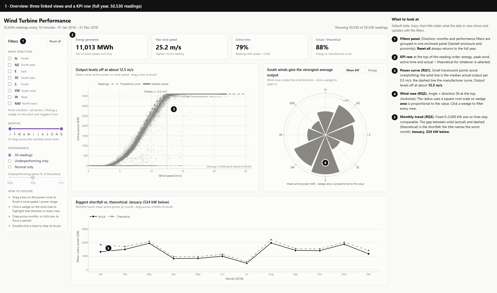
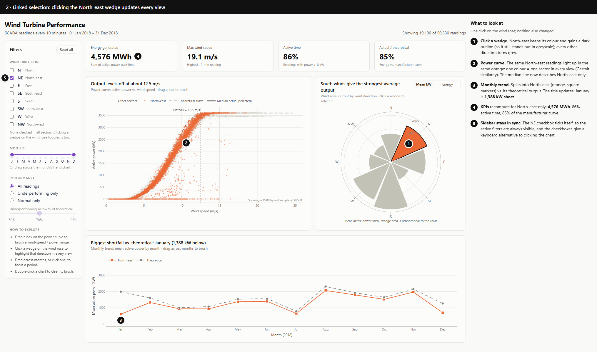
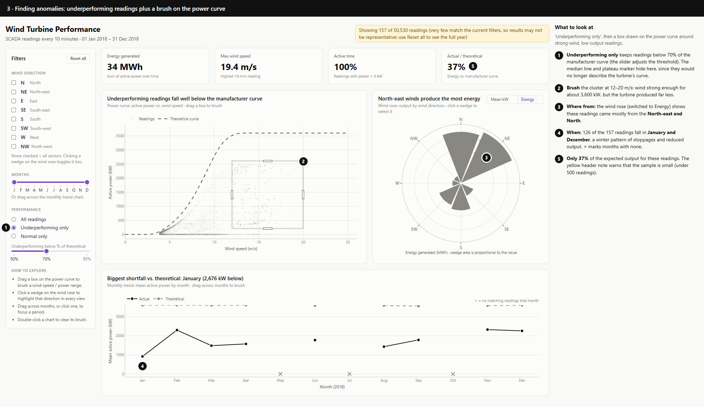

# Wind Turbine Performance Dashboard

Interactive Plotly Dash dashboard for the [Wind Turbine SCADA dataset](https://www.kaggle.com/datasets/berkerisen/wind-turbine-scada-dataset).
It has three linked views (power curve, wind rose, monthly trend) with cross-filtering and a KPI row.

**Live prototype:** https://wind-turbine-dashboard.onrender.com
(The free host sleeps when idle, so the first load can take about a minute.)

**Repository:** https://github.com/rohithanbu/wind-turbine-dashboard

### Annotated screenshots





## Run locally

Requires **Python 3.11 or newer** (tested with Python 3.14) and Git.

```bash
git clone https://github.com/rohithanbu/wind-turbine-dashboard.git
cd wind-turbine-dashboard
python -m venv .venv
.venv\Scripts\activate            # macOS/Linux: source .venv/bin/activate
pip install -r requirements.txt
python app.py
```

Then open **http://127.0.0.1:8050** in a browser. Press `Ctrl+C` in the terminal to stop the server.

- The dataset (`data/T1.csv`) is included in the repository, so no Kaggle account or download is needed.
  To fetch a fresh copy from Kaggle instead, run `python scripts/download_data.py`.
- The page loads the Dash and Plotly JavaScript from their public CDN (faster than serving it from the app), so the
  browser needs an internet connection.
- If port 8050 is already in use, stop the other process, or change the port in `app.py`: `app.run(debug=True, port=8051)`.
- On macOS/Linux, use `python3` in place of `python` if `python` isn't found.

## Dataset

`T1.csv`: SCADA readings from **one wind turbine** (in Turkey, per the Kaggle description), logged every 10 minutes from 1 Jan to 31 Dec 2018,
**50,530 rows**. The full file is loaded; every filter and KPI uses all rows.

| Dimension | Source | Type | Used for |
|---|---|---|---|
| Active power (kW) | raw | Quantitative | Scatter y, wind-rose radius, line y, KPIs |
| Wind speed (m/s) | raw | Quantitative | Scatter x, max-wind KPI |
| Theoretical power (kW) | raw | Quantitative | Dashed reference curve, performance ratio |
| Wind direction (°) | raw | Quantitative, binned into sectors | Sector (below) |
| Wind direction sector (N … NW) | derived | Nominal (categorical, circular order) | Wind-rose angle; hue for selected sectors in all views |
| Timestamp | raw | Ordinal (time) | Header date range |
| Month (Jan … Dec) | derived | Ordinal | Line x, month filter |
| Performance ratio (actual ÷ theoretical) | derived | Quantitative | "Underperforming" filter, KPI |

## Research questions and views

| # | Research question | Answered by |
|---|---|---|
| RQ1 | How does active power correlate with wind speed, and at what wind speed does the turbine reach peak efficiency before the power curve flattens? | **Power curve** scatter (with theoretical curve and plateau marker) |
| RQ2 | Which wind direction sectors consistently yield the highest power generation, and does this efficiency change across different months? | **Output by wind direction** wind rose, linked to the **Monthly trend** line (one line per selected sector) |
| RQ3 | When cross-filtering by low-performance periods, do anomalies appear in the theoretical vs actual power curve? | **Performance** filter ("Underperforming only") applied to all three views and the KPI row |

## Findings

All figures are computed from the full 2018 dataset. The **"See it in the dashboard"** steps reproduce each one.

### RQ1: Power vs. wind speed, and where the curve flattens

**Active power is strongly correlated with wind speed** (Pearson r = 0.91; Spearman ρ = 0.93), but the relationship is an
S-shaped power curve, not a straight line:

| Wind speed | Typical output (median) | Phase |
|---|---|---|
| below ~3 m/s | 0 kW | Below **cut-in**: too little wind to generate |
| 4–8 m/s | 86 → 1,363 kW | Output rises |
| **9–10 m/s** | 1,887 → 2,402 kW | **Steepest gain: about +520 kW per extra 1 m/s** |
| 12–13 m/s | 3,311 → 3,551 kW | Approaching rated power |
| **≥ 14 m/s** | **≈ 3,600 kW, flat** | **Rated power**: more wind adds no output |

- **The curve flattens at about 12.5 m/s.** This is where median output first reaches 95% of its maximum (the dotted
  "Plateau" line on the power curve). It is fully flat at about 3,600 kW from 14 m/s.
- **"Peak efficiency" has two readings, and the data answers both:**
  - The turbine *gains* power fastest at **9–10 m/s**.
  - It tracks its manufacturer curve most closely at **13 m/s and above**, at 93–99% of theoretical, compared with
    only about 68% around 4 m/s, just above cut-in.

**See it in the dashboard:** with no filters set, the power curve shows the S-shape, the dashed theoretical curve and the
"Plateau ≈ 12.5 m/s" marker. Hover over points for exact values.

### RQ2: Which directions produce the most, and does it change by month?

**Over the year, North-east and South dominate:**

| Sector | Energy (MWh) | Share of time | Mean power |
|---|---|---|---|
| **North-east** | **4,576** (42% of all energy) | **38%** | 1,431 kW |
| **South** | 2,428 | 14% | **2,075 kW** (highest) |
| South-west | 1,721 | 13% | 1,577 kW |
| East | 1,382 | 15% | 1,115 kW |
| N, W, NW, SE | 92–498 each | 3–8% each | 325–747 kW |

North-east produces the most energy because the wind comes from there most often. South has the strongest winds but
blows less often.

**The leading direction changes with the season:**
- **Winter (Dec–Mar): South leads.** In March, South and South-west together give 1,284 MWh.
- **Apr–Nov: North-east leads every month.** August NE (1,207 MWh) is the largest single sector-month of the year.
  In August, the S, SW, W and NW sectors produced almost nothing.

**Efficiency (actual ÷ theoretical) changes by month too:**
- Most sector-month combinations sit at **85–95%**.
- **South is the most consistent**, at 83–98% in every month except July (76%). In August, South had too little
  wind for a ratio.
- The low outliers are concentrated in winter: **North-east in January (30%)** and **December (55%)**, and **North in
  January (52%)**.
- So the drop is driven by the *month*, not by the direction itself. That leads into RQ3.

**See it in the dashboard:**
1. Switch the wind rose between **Mean kW** and **Energy** to compare strength with total output.
2. Click the **NE** wedge, then the **S** wedge. The monthly trend draws one line per selected sector against the
   theoretical line, showing the seasonal swap.

### RQ3: Do anomalies appear when filtering to low-performance periods?

**Yes.** With **"Underperforming only"** selected (below 70% of theoretical, among readings where theoretical power
is at least 100 kW), **4,254 of 39,288 readings (10.8%)** remain. In those readings, actual output fell short of the
theoretical curve by about **721 MWh**, about 6% of the 12,567 MWh the curve predicts for the year.
Three distinct anomaly types appear:

1. **Full stoppages:** a line of points at 0 kW while the wind was blowing.
   - 1,852 readings produced nothing while the curve expected real output.
   - The longest stoppage was **24–26 January: 44.5 hours at 0 kW** in an average wind of 9.6 m/s, when the
     curve predicts about 2,500 kW on average.
   - Other long stops: 14 Jan (21 h), 25 Feb (16 h), 4 Dec (16 h), 19 Dec (14 h).
2. **Partial output in strong wind:** at 12 m/s and above, where the turbine should be near 3,600 kW, some readings
   form flat horizontal clusters, notably around **2,250–2,500 kW** and **250–500 kW**. A second flat band just under
   rated power (**3,400–3,500 kW**, 683 readings above 14 m/s) is visible in the unfiltered view. Flat lines like these
   suggest deliberate output limits (curtailment or derating) rather than random noise.
3. **A winter cluster:** underperformance is seasonal.

   | Month | Share of readings underperforming |
   |---|---|
   | **January** | **28%** |
   | **December** | **28%** |
   | April | 17% |
   | February | 14% |
   | August, October | 2% (lowest) |

   By direction, **N, NW and W** underperform most (19–22% of their readings) and **South** least (5%).

The winter pattern, with long stops in moderate wind, is consistent with icing, cold-weather shutdowns or winter
maintenance. **The dataset has no fault or status codes**, so the cause can't be confirmed from this data alone.

**See it in the dashboard:**
1. Select **Underperforming only**. The power curve shows the 0 kW line and the partial-output clusters below the
   dashed curve, and the actual ÷ theoretical KPI drops from 88% to 18%.
2. Look at the monthly trend: the gap between actual and theoretical is largest in **January and December**.
3. Drag a box around the partial-output points at 12+ m/s on the power curve. The wind rose and monthly trend update to
   show which directions and months they came from.
4. Use the threshold slider (50–95%) to test how sensitive the result is to the 70% cut-off.

### Data-quality notes

- **2,030** of 52,560 expected 10-minute intervals are missing (mostly January and September–November).
- **57** readings show slightly negative power (down to −2.5 kW): the turbine drawing power while idle.
- **About 1,080** readings are more than 10% *above* the theoretical curve, mostly at low wind speeds, where the
  manufacturer curve is least precise.

## Data preparation

All preparation is in [`dashboard/data.py`](dashboard/data.py):

| Step | What and why |
|---|---|
| Column renaming | The 5 raw columns are renamed by position (`timestamp`, `active_power`, `wind_speed`, `theoretical_power`, `wind_direction`), because the degree sign in `Wind Direction (°)` is mis-encoded in the CSV. The file is read as Latin-1 for the same reason. |
| Date parsing | `Date/Time` is parsed with the explicit format `DD MM YYYY HH:MM`, and `month` (1–12) is derived from it. |
| Direction binning | Wind direction (0–360°) is binned into 8 compass sectors of 45° each (N, NE, … NW), each centred on its heading, so N covers 337.5°–22.5°. |
| Performance ratio | `perf_ratio = active_power / theoretical_power`, computed only where theoretical power is at least 100 kW. Below cut-in the denominator is near zero and the ratio would be noise. Readings below 70% (adjustable from 50–95%) count as "underperforming". |
| Negative power | The 57 negative readings are kept as-is in the charts and clipped to 0 when summing energy. |
| Missing intervals | The 2,030 missing intervals are left as gaps, not interpolated; monthly figures are means of the readings that exist. On the monthly trend, a month with no matching readings for a line is marked with an × on the baseline. |
| Aggregation | The wind rose gives the per-sector mean power and energy (MWh = kW × 1/6 h ÷ 1000). The trend chart gives mean power per month. The theoretical curve is averaged into 0.5 m/s bins. The power curve's solid **median line** is the median active power per 0.5 m/s bin (bins with at least 20 readings). The plateau marker is the wind speed where that median first reaches 95% of its peak. The median line and plateau marker are hidden in "Underperforming only" mode, where they would not describe the turbine's curve. |
| Scatter sampling | The scatter draws a fixed random sample of 15,000 small, translucent points so the page stays responsive and dense regions read darker. It is labelled as a sample on the chart. Filters, KPIs, the median line and the other views always use the full data. |

## Visual encodings

| Data | Type | Mark | Channel | View |
|---|---|---|---|---|
| Active power | Quantitative | Point / wedge / line | Y-position (fixed 0 to rated power); on the wind rose, wedge **area** (radius on a square-root scale) | All three |
| Median active power | Quantitative (aggregated) | Line | Position, **solid** line over the points | Power curve |
| Wind speed | Quantitative | Point | X-position | Power curve |
| Theoretical power | Quantitative | Line | Position, **dashed** line style | Power curve, monthly trend |
| Wind direction sector | Nominal, circular | Wedge | **Angle** (compass, N at the top, clockwise) | Wind rose |
| Selected sectors | Nominal | Point / wedge / line | **Colour hue** (fixed per sector, up to 3; one shared colour beyond that), backed by a dark **outline** on the selected wedges and a **marker shape** per sector on the monthly lines; everything unselected stays neutral grey | All three |
| Month | Ordinal | Line | X-position, left to right | Monthly trend |

Legends stay at six items or fewer, and each card title is a sentence about the data in view (for example
"Output levels off at about 12.5 m/s") that updates with the filters; the subtitle says what the chart encodes.

## Changes from the proposal

The channel justification table in the proposal is followed, with these changes:

| Proposal | Implementation | Reason |
|---|---|---|
| Wind direction → **colour hue** on the scatter points | Everything is one **neutral grey by default**. Hue appears only as a **highlight for the sectors the user selects** (up to 3), in every view; with more than 3 selected, the selection shares one colour. | Eight hues on ~50,000 overlapping points can't be told apart, especially by colour-blind viewers, and colour noise hides the power-curve shape that RQ1 asks about. One neutral hue plus a highlight keeps hue for identity only (expressiveness), and only where it can be read. |
| *(not in table)* | **New wind rose:** wind direction sector → **angle** (compass layout, N at the top, clockwise); mean power or energy → **wedge area**, using a square-root radius. | Wind direction is circular, so a polar layout matches the data and the reader's compass mental model, which a linear axis would break (N and NW would sit at opposite ends). Readers judge wedges by area (Stevens' power law), and with a linear radius the area would grow with the square of the value and exaggerate the differences. It answers RQ2's comparison of sectors. |
| *(not in table)* | **Redundant cues for the selection:** a dark outline on selected wedges, and a distinct marker shape per sector on the monthly lines. | Colour alone fails in greyscale and for some colour-vision deficiencies; outline and shape keep the selection readable without hue. |
| *(not in table)* | **Median actual power** → a **solid line** over the scatter; the points are small and translucent. | 50,000 points overplot. The binned median summarises the actual curve, and translucency lets dense regions read darker. The gap between the solid median and the dashed theoretical line shows RQ1's plateau and RQ3's shortfall directly. |
| *(not in table)* | **Theoretical power** → a **dashed line** on the scatter and on the monthly trend; actual power is solid. | RQ3 compares actual against theoretical. A shared position scale makes the gap directly readable, and line style separates expected from measured. |
| *(not in table)* | The monthly trend's y-axis is **fixed from 0 to rated power** (3,600 kW). | A fixed domain keeps lines comparable when the selection changes, instead of rescaling the axis each time. |

The rest matches the proposal: active power → y-position, wind speed → x-position, time (months) →
x-position flowing left to right on a line, and a side-panel layout with a KPI row.

## Interaction

- **Wind rose:** click a wedge to select that sector in every view (it toggles the sidebar checkbox too).
- **Power curve:** drag a box to brush a wind-speed / power range; the other views and the KPIs update.
- **Monthly trend:** click a month or drag across several to filter the period.
- **Sidebar:** direction checkboxes, month range, performance mode and threshold, and **Reset all**.
- **KPI row and reading count:** always summarise the readings that match every active filter. The page opens on
  the full year; if the filters leave fewer than 500 readings, or none, a highlighted message says so and points to
  **Reset all**.
- Every chart has hover tooltips; double-click a chart to clear its brush.
- While a view or KPI recomputes it dims briefly and fades back in with the new state, so every linked update is
  visible (the fade is turned off when the system asks for reduced motion).

## Layout

The layout follows a Z-pattern: title and reading count first, then the KPI row, then the views. Each view sits in its
own card (enclosure), the two views that share the wind-speed / direction question sit side by side above the
full-width time view (proximity), and a sector keeps the same colour in every view (similarity). All filters live in
one sidebar panel with **Reset all** at the top. Below about 1,200 px wide the views stack; below about 860 px the
sidebar moves above them, and the layout works down to phone width without horizontal scrolling.

## Deployment (Render)

`render.yaml` defines a free Render web service: `pip install -r requirements.txt`, then
`gunicorn app:server`. In Render, choose **New → Blueprint** and point it at this repository.
`gunicorn` is only used on the server; locally, run `python app.py`.

## Structure

```
app.py                  entry point: builds the app, registers callbacks
dashboard/
  config.py             paths, columns, sectors, thresholds, colour system
  data.py               load + derive columns; Filters = the cross-filter state
  figures.py            pure figure builders + KPI maths (no Dash imports)
  layout.py             component tree (sidebar, KPI row, chart cards)
  callbacks.py          selections -> filter state -> views
assets/style.css        tokens, layout grid, responsive breakpoints
data/T1.csv             the dataset
scripts/download_data.py
render.yaml             Render deployment config
screenshots/            annotated screenshots used in this README
```

## Credits and references

- **Dataset:** *Wind Turbine Scada Dataset*, published on Kaggle by user `berkerisen`,
  https://www.kaggle.com/datasets/berkerisen/wind-turbine-scada-dataset
- **Libraries:** [Plotly Dash](https://dash.plotly.com/) and [Plotly](https://plotly.com/python/) (charts and
  interactivity), [pandas](https://pandas.pydata.org/) and [NumPy](https://numpy.org/) (data preparation),
  [kagglehub](https://github.com/Kaggle/kagglehub) (dataset download).
- **Cross-filtering pattern:** based on the "Interactive Visualizations" chapter of the Dash documentation
  (`selectedData` / `clickData` driving the other figures), https://dash.plotly.com/interactive-graphing
